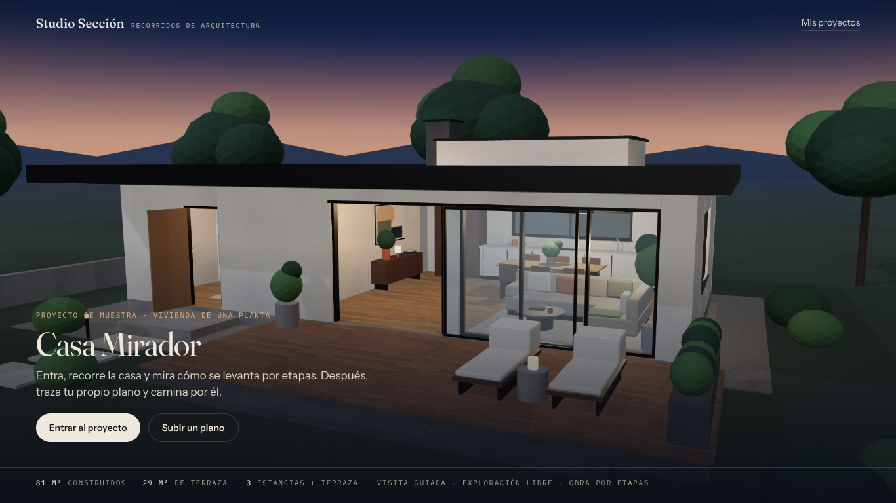
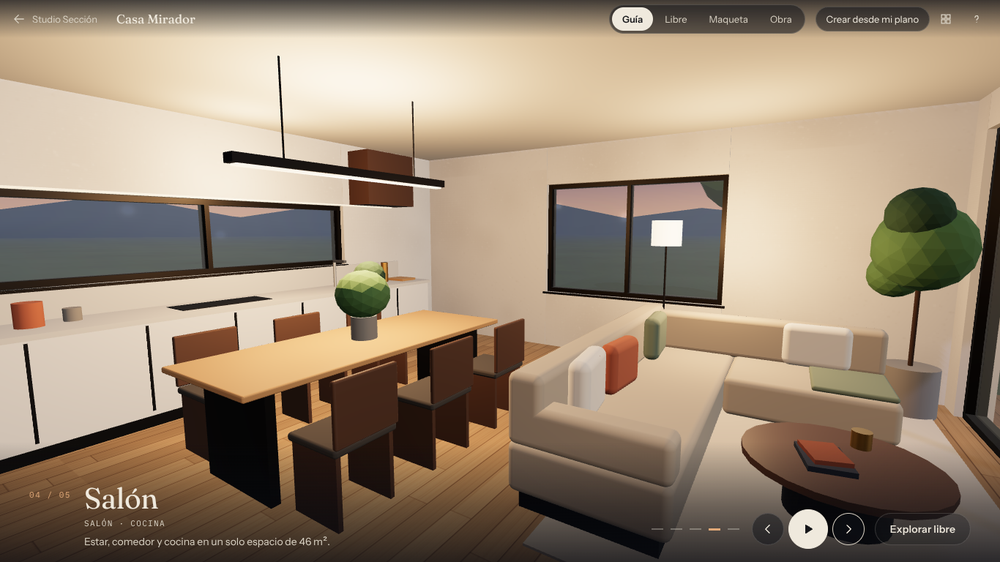
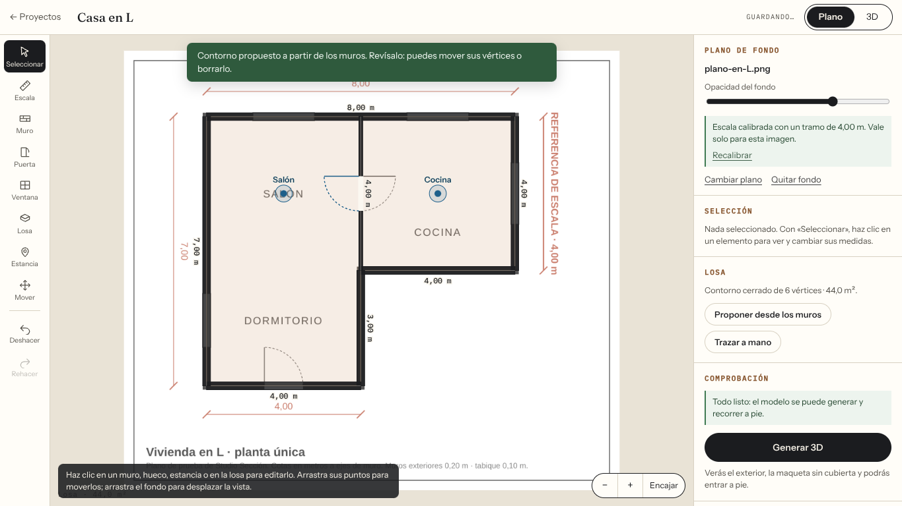
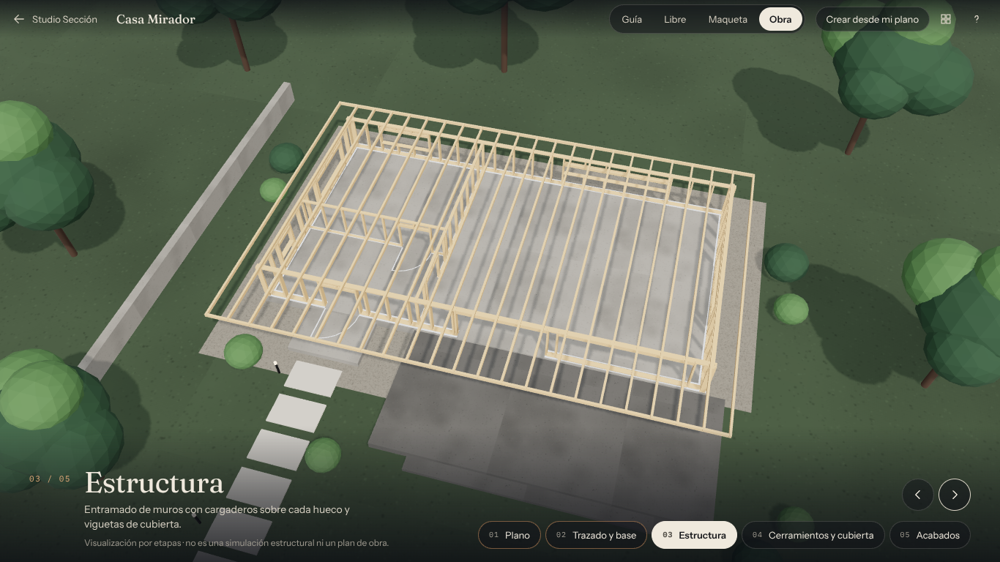

# Studio Sección

Aplicación web para presentar proyectos de arquitectura como recorridos inmersivos. Tiene dos puertas de entrada desde la portada:

- **Explorar el proyecto de muestra** — *Casa Mirador*, una vivienda original de una planta con visita guiada, exploración libre, maqueta y obra por etapas.
- **Crear desde mi plano** — subes un PDF, PNG o JPG, calibras la escala, trazas muros, huecos, losa y estancias, y obtienes **otro** modelo 3D, el de tu plano, que puedes recorrer a pie.

Interfaz en español. Sin cuentas, sin claves y sin servicios de terceros: todo ocurre en el navegador.



| Interior de la demo | Proyecto propio (maqueta) |
| --- | --- |
|  |  |

| Editor del plano | Obra por etapas |
| --- | --- |
|  |  |

Todas las capturas salen de la propia app (`npm run e2e` y `npm run capturas`), no de renders externos.

---

## Comandos

Requisitos: **Node ≥ 20.19** y npm.

```bash
cd studio-seccion
npm install
```

```bash
npm run dev
```

Abre <http://localhost:5173>.

```bash
npm test
```

Pruebas unitarias (Vitest): geometría, segmentación de muros, colisiones, validación, recorrido de la demo, formatos de plano y persistencia.

```bash
npm run typecheck
```

```bash
npm run build
```

Compila a `dist/` (rutas relativas: se puede servir desde cualquier carpeta estática).

```bash
npm run preview
```

Sirve `dist/` en <http://localhost:4173>.

```bash
npm run e2e
```

Pruebas de extremo a extremo en Chromium contra `http://127.0.0.1:4173/` (deja `npm run preview` abierto en otra terminal). Para apuntar a otro servidor: `BASE_URL=http://127.0.0.1:5173/ npm run e2e`. Para ejecutar solo una parte: `SOLO=demo`, `SOLO=movil`, `SOLO=plano` o `SOLO=editor-movil`.

Los scripts de navegador (`e2e`, `capturas`, `plano:ejemplo`) necesitan Playwright, que **no** es dependencia de la app:

```bash
npm i -D playwright
```

```bash
npx playwright install chromium
```

```bash
npm run capturas
```

Regenera el póster de la portada (`public/poster-casa-mirador.jpg`) a partir de la escena 3D.

```bash
npm run plano:ejemplo
```

Regenera el plano de prueba en `public/ejemplos/`.

---

## Recorrido de validación (dos minutos)

**1. La casa de muestra**

1. Portada → **Entrar al proyecto**. Abre sin iniciar sesión, en el capítulo *Exterior*.
2. Pulsa **▸** (o Espacio) o avanza con **›**, las flechas ← → o la rueda sobre la escena: *Exterior → Acercamiento → Terraza → Salón → Dormitorio*.
3. A mitad de un tramo pulsa pausa y después **Explorar libre**: sigues en el mismo punto, con la insignia «Modo libre». Arrastra para mirar; camina con W A S D o las flechas (en táctil, con el mando). Los muros y la cristalera fija te paran; la corredera de la terraza y las puertas, no.
4. **Volver a la guía** te devuelve al capítulo más cercano.
5. **Maqueta** retira la cubierta y rotula estancias y cotas de muros.
6. **Obra** → *Plano → Trazado y base → Estructura → Cerramientos y cubierta → Acabados*. Avanza, retrocede o salta a cualquier etapa: es la misma casa con geometría distinta en cada una.

**2. Tu propio plano**

1. Portada → **Subir un plano** → escribe un nombre → **Crear proyecto**.
2. Sube `public/ejemplos/plano-en-L.pdf` o `plano-en-L.png` (o pulsa «Plano de ejemplo»).
3. **Escala**: marca los dos extremos de la cota roja «REFERENCIA DE ESCALA · 4,00 m», escribe `4` y **Aplicar escala**.
4. **Muro**: haz clic en las seis esquinas del contorno en L y vuelve al primer punto para cerrarlo. Después traza el tabique interior (de arriba abajo, 4 m).
5. **Puerta**: clic sobre el tabique. **Losa** → *Proponer desde los muros*. **Estancia**: clic dentro de una habitación y ponle nombre.
6. **Generar 3D**: exterior → maqueta sin cubierta → **Libre** → entra por la estancia. Pasas por la puerta y no por el muro.
7. **Volver al plano**, selecciona la puerta, cambia «Distancia al inicio del muro» y vuelve a generar: el hueco y la colisión se han movido.
8. Recarga la página o vuelve a *Mis proyectos*: el proyecto sigue ahí con el plano, la escala y los cambios.

---

## Plano de prueba

`public/ejemplos/plano-en-L.pdf` y `plano-en-L.png` — dibujo original de este proyecto (lo genera `scripts/generar-plano-ejemplo.mjs`).

- Vivienda en **L** de 8 × 7 m, distinta de Casa Mirador: ala superior de 8 × 4 m y ala inferior de 4 × 3 m.
- Muros exteriores de 0,20 m, tabique interior de 4 m (0,10 m) con una puerta centrada.
- Cota de referencia de **4,00 m** en el muro este para calibrar. Cotas a ejes de muro.

Resultados esperados: muros de 8 · 4 · 4 · 3 · 4 · 7 m, losa de 44 m² y tabique rotulado «4,00 m» tanto en el editor como en la maqueta 3D.

---

## Qué está implementado

**Casa Mirador**

- Portada con póster local y carga diferida del visor (Three.js no se descarga hasta entrar).
- Visita guiada exterior → acercamiento → terraza → salón → dormitorio por tramos de curva con puntos intermedios, suavizado de arranque y llegada, altura de ojos de 1,60 m en interiores. Inicio, pausa, avance, retroceso, capítulos por botones, teclado y rueda (solo sobre el visor y solo en modo guía).
- Exploración libre: órbita exterior y recorrido a pie con colisiones, mando táctil, reinicio de cámara y puntos de entrada seguros. Insignia visible de «Modo libre».
- Maqueta sin cubierta con nombres de estancia y cotas.
- Obra por etapas reversible con cinco grupos de geometría: plano/trazado, base, estructura (entramado con cargaderos y viguetas), cerramientos + carpinterías + cubierta, acabados + mobiliario.
- Acabados predefinidos (paredes, fachada, pavimento) aplicados como color y mapa de detalle del material.
- Niveles de calidad (alta/media/baja), render bajo demanda (en reposo no se dibuja ningún fotograma), `prefers-reduced-motion` (los travellings pasan a ser fundidos) y aviso claro si no hay WebGL.

**Crear desde mi plano (una planta)**

- Carga local de PDF (PDF.js, con selector de página), PNG y JPG. Validación por firma binaria, límite de 40 MB y mensajes útiles para archivos inválidos, vacíos, demasiado grandes o protegidos.
- Fondo 2D con zoom, desplazamiento, pellizco y opacidad. Opción de trazar sin fondo sobre cuadrícula de 1 m.
- Calibración con dos puntos y una longitud real. Sin calibrar no se muestran cotas ni se puede trazar. Al recalibrar, lo trazado se reajusta al dibujo. La escala se invalida al cambiar de página o de archivo.
- Muros por clics con imán a extremos, a cuerpo de muro (encuentros en T) y enderezado ortogonal. Largo, grosor y altura editables; mover extremos (las esquinas unidas se mueven juntas), mover y borrar.
- Puertas y ventanas referidas a su muro por posición y dimensiones; se arrastran a lo largo del muro. No se aceptan huecos fuera de muro, superpuestos ni más altos que el muro.
- Losa por contorno trazado o propuesto desde los muros y validado por el usuario; se rechazan contornos autointersectados.
- Estancias con nombre y punto de cámara.
- Deshacer/rehacer de toda la geometría (un arrastre = un paso).
- Panel de comprobación que explica qué falta y lleva a la herramienta que lo corrige.
- Generación 3D desde la geometría confirmada: losa extruida, muros con espesor real partidos en macizos, dinteles y antepechos, carpinterías con marco. Visita exterior → maqueta → interior validado; modo libre con colisiones derivadas de los mismos huecos.
- Etapas para un plano propio: *Trazado → Losa → Muros y huecos → Acabados*, esta última marcada «Ilustrativo». No se inventan cimentación, estructura, cubierta ni mobiliario.
- Guardado automático en IndexedDB (proyecto + archivo original), reapertura, eliminación y aviso de que el proyecto solo vive en ese navegador.

## Qué queda pendiente (no implementado)

- Importación de **GLB** local para proyectos que ya tienen modelo 3D.
- Importación **DXF / DWG / IFC** y proyectos de varias plantas.
- Interpretación automática del plano (visión por IA): hoy el plano es solo un fondo para trazar.
- Publicación, enlace compartible, colaboración y almacenamiento remoto.
- Cubierta, mobiliario e iluminación interior para planos propios (el modelo generado es deliberadamente una maqueta abierta).
- Recorrido guiado *continuo* entre estancias de un plano propio: entre puntos interiores se usa un fundido porque no hay un camino comprobado; el desplazamiento se hace en modo libre.
- Exportación de imágenes o vídeo.

---

## Arquitectura

```
src/
  model/      Esquema del proyecto (v1, metros), geometría 2D, validación, migración
  generate/   Generación paramétrica: muros→piezas, carpinterías, entramado, trazado, colisiones
  editor/     Editor 2D: estado + historial, imanes, lienzo SVG, carga de PDF/imagen
  viewer/     Visor 3D: definición de escena, cámara, materiales, texturas, lienzo R3F, interfaz
  demo/       Casa Mirador: proyecto, piezas propias, recorrido y encuadres
  storage/    IndexedDB (proyectos y archivos)
  pages/      Portada, mis proyectos, espacio de trabajo
scripts/      Plano de ejemplo, póster y pruebas de extremo a extremo
```

- **Una sola fuente de verdad.** El proyecto guarda muros (segmento + grosor + altura), huecos (muro + posición + dimensiones), losa (contorno), estancias (punto de cámara), acabados y calibración. El editor 2D, la geometría 3D y las colisiones se derivan de ese estado; no hay una segunda copia que sincronizar.
- **La demo usa el mismo modelo.** Casa Mirador es un `Project` más (`demo/casaMirador.ts`), con piezas añadidas (cubierta, terraza, mobiliario, entorno) declaradas como datos. Por eso la casa es la misma en todos los modos y las etapas solo muestran u ocultan capas.
- **Huecos reales.** `generate/walls.ts` parte cada muro en macizos, dinteles y antepechos; `generate/collision.ts` usa esos mismos intervalos (todo bloquea salvo las puertas).
- **Recorrido comprobable.** `viewer/tour.ts` no depende del DOM; `demo/tour.test.ts` muestrea las mismas curvas que dibuja el visor y comprueba que ningún tramo a pie toca muros, vidrios ni muebles.
- **Esquema versionado** (`schemaVersion: 1`) con `migrateProject`, que rechaza datos ajenos o de versiones futuras con un mensaje legible.
- **Rutas por hash** y `base: './'`: el build es un conjunto de archivos estáticos.

## Decisiones técnicas

- **Stack:** React 19, TypeScript, Vite, Three.js + React Three Fiber, PDF.js, Zustand. El repositorio contenía otro producto (TrendHunter Pro, Next.js), incompatible con este encargo, así que Studio Sección vive aislado en `studio-seccion/` con su propio `package.json`; del proyecto existente solo se tocó `tsconfig.json` para excluir esta carpeta de su comprobación de tipos.
- **Escena procedural, sin activos externos.** No había un pipeline para modelar y hornear iluminación, de modo que la demo es geometría paramétrica con materiales PBR, texturas dibujadas en canvas con repetición por metros reales, luz ambiente, sol con sombras suaves, luces interiores cálidas y entorno de reflexión generado en local. **No es un render fotorrealista**: faltan iluminación global horneada, texturas fotográficas con relieve, modelos de mobiliario detallados y oclusión ambiental. La dirección artística (atardecer azul, interior cálido, encuadres) está; el acabado de producción exigiría un modelo GLB con lightmaps. Tampoco se promete ese acabado para planos subidos.
- **Sin posprocesado.** No hay bloom ni reflejos en pantalla; el aspecto depende de la geometría, la luz y el mapeo de tonos.
- **Acabados editables no horneados:** el color está en el material y la textura es un mapa de detalle casi neutro.
- **Cortes con fundido** siempre que un cambio de cámara atravesaría un interior (volver a la guía, entrar por una estancia, saltar de capítulo); los cambios entre vistas exteriores vuelan en arco alrededor del edificio.
- **Privacidad:** el plano y el modelo no salen del navegador. No hay telemetría, fuentes remotas ni CDN; PDF.js y su *worker* se sirven desde la propia app y no siguen recursos externos del archivo.
- **La losa es exactamente el contorno validado.** Si se traza a ejes de muro, la mitad exterior del muro vuela sobre el canto de la losa; no se corrige automáticamente para no inventar geometría.

## Procedencia de activos y licencias

| Activo | Origen | Licencia |
| --- | --- | --- |
| Casa Mirador (geometría, mobiliario, entorno) | Creada para este proyecto, en código | Propia |
| Texturas (madera, revoco, hormigón, terrazo, césped…) | Procedurales, `viewer/textures.ts` | Propia |
| Póster de portada | Captura de la escena de la app (`npm run capturas`) | Propia |
| Plano de prueba (PDF/PNG) | `scripts/generar-plano-ejemplo.mjs` | Propia |
| Entorno de reflexión | `RoomEnvironment` de los ejemplos de Three.js, generado en ejecución | MIT |
| Fraunces, Instrument Sans | Paquetes Fontsource, servidos en local | SIL OFL 1.1 |
| IBM Plex Mono | Paquete Fontsource, servido en local | SIL OFL 1.1 |
| Three.js, React Three Fiber, React, Zustand | npm | MIT |
| PDF.js (`pdfjs-dist`) | npm | Apache-2.0 |

No se empaquetan vídeos, imágenes ni modelos de terceros.

---

## Verificación realizada

Ejecutado en este entorno (contenedor Linux, Chromium sin GPU con WebGL por software):

| Qué | Resultado |
| --- | --- |
| `npm test` | 40 pruebas unitarias correctas |
| `npm run typecheck` | sin errores |
| `npm run build` | correcto |
| `npm run e2e` sobre el build de producción | 78 comprobaciones correctas (ver detalle abajo) |

Lo que cubren las pruebas de extremo a extremo:

- **Demo en escritorio:** portada con las dos entradas; los cinco capítulos en orden; altura de ojos de 1,60 m; retroceso con teclado; pausa a mitad de tramo (la cámara se detiene y deja de dibujarse); paso a modo libre sin cambiar de sitio; caminar con teclado; el muro este y la cristalera fija bloquean, la corredera abierta no; reinicio de cámara; vuelta a la guía; maqueta sin cubierta; cinco etapas con capas distintas, vuelta a una etapa anterior idéntica a la primera vez y nuevo avance.
- **Demo en móvil (390 × 844, táctil):** botones táctiles, mando para caminar, tamaño del panel inferior.
- **Movimiento reducido:** el cambio de capítulo es un fundido, sin travelling.
- **Plano propio:** archivo inválido; PNG, PDF, PDF de dos páginas y JPG; calibración de 4 m; contorno en L (8 · 4 · 4 · 3 · 4 · 7 m); tabique de 4,00 m con la misma cota en editor y modelo; puerta como hueco real con dintel; paso por la puerta y bloqueo en el muro; mover la puerta actualiza 3D y colisión; rechazo de huecos imposibles; deshacer/rehacer; acabados; recarga completa del navegador conservando plano, escala y cambios; proyecto sin estancia válida (se explica qué falta); proyectos separados y eliminación.
- **Sin WebGL (simulado):** con el contexto 3D bloqueado aparece el mensaje alternativo y el plano 2D sigue accesible.
- **Red:** ninguna petición sale del origen de la app; sin errores de consola.

Durante el desarrollo una comprobación (ajustar el grosor de un muro) falló de forma intermitente en una pasada: el campo numérico podía confirmar el valor anterior si se pulsaba Intro en el mismo instante de teclear. Se corrigió leyendo el valor del propio campo y la batería completa volvió a pasar.

**Sin verificar** (queda fuera de lo que este entorno permite comprobar):

- **Rendimiento y fluidez en hardware real.** Aquí WebGL corre por software (~2–10 fotogramas por segundo según la calidad), así que no hay medidas reales de FPS en ordenadores ni en móviles. Reproducción: abrir `#/demo`, elegir calidad en el panel de ayuda (`?`) y recorrer la visita.
- **Dispositivos táctiles físicos.** El móvil se probó con emulación de Chromium (viewport, eventos táctiles); no en iOS/Android reales.
- **Safari y Firefox.** Solo se ejecutó Chromium.
- **Ausencia real de WebGL.** Se probó bloqueando el contexto 3D desde la prueba, no en un equipo que de verdad carezca de él. Reproducción: Chromium con `--disable-gpu --disable-software-rasterizer` y abrir `#/demo`.
- **Cuota de almacenamiento agotada.** Los errores de cuota se traducen a mensajes, pero no se forzó un disco lleno.
- **PDF reales de estudio** (grandes, vectoriales complejos o escaneados): solo se probaron el plano de ejemplo y un PDF sintético de dos páginas.

Los vídeos de referencia (46717, 46718, 46719) no estaban adjuntos en la sesión de trabajo: la experiencia se construyó a partir de su descripción en el encargo.
