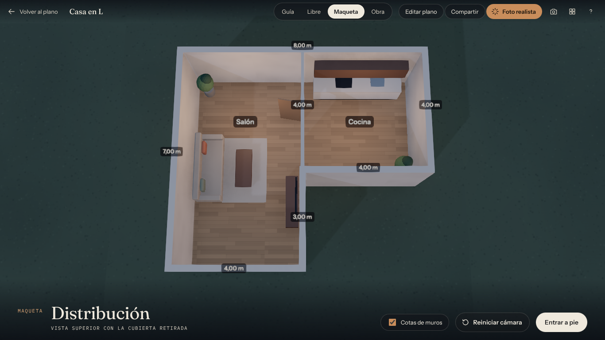

# Studio Sección

Aplicación web para presentar proyectos de arquitectura e inmuebles como recorridos 3D. **En producción: <https://studio-seccion.vercel.app>.**

Desde la portada hay tres entradas:

- **Entrar al proyecto** — *Villa Mirador*, una villa de muestra de 187 m² con piscina: visita guiada, exploración libre a pie, maqueta, obra por etapas, foto realista y vídeo.
- **Subir un plano** — subes un PDF, PNG o JPG de una planta, calibras la escala y trazas muros, huecos, losa y estancias. Obtienes **otro** modelo 3D, el de tu plano, que puedes recorrer, amueblar (de forma ilustrativa) y compartir por enlace.
- **Ver una promoción de pisos** — *Residencial Alameda*, un edificio de ejemplo con 12 viviendas. El cliente elige su piso en la fachada y entra a recorrerlo a su altura real.

Interfaz en español. Sin cuentas, sin claves y sin servidor propio: el trabajo ocurre en el navegador.


| Interior de la demo | Proyecto propio (maqueta) |
| --- | --- |
|  |  |

| Editor del plano | Obra por etapas |
| --- | --- |
|  |  |

Todas las capturas salen de la propia app (`npm run e2e` y `npm run capturas`), no de renders externos.

---

## Comandos

Requisitos: **Node ≥ 20.19** y npm.

```bash
cd studio-seccion
npm install
```

```bash
npm run dev
```

Abre <http://localhost:5173>.

```bash
npm test
```

Pruebas unitarias (Vitest): geometría, segmentación de muros, colisiones, validación, recorrido de la demo, formatos de plano y persistencia.

```bash
npm run typecheck
```

```bash
npm run build
```

Compila a `dist/` (rutas relativas: se puede servir desde cualquier carpeta estática).

```bash
npm run preview
```

Sirve `dist/` en <http://localhost:4173>.

```bash
npm run e2e
```

Pruebas de extremo a extremo en Chromium contra `http://127.0.0.1:4173/` (deja `npm run preview` abierto en otra terminal). Para apuntar a otro servidor: `BASE_URL=http://127.0.0.1:5173/ npm run e2e`. Para ejecutar solo una parte: `SOLO=demo`, `SOLO=movil`, `SOLO=plano` o `SOLO=editor-movil`.

Los scripts de navegador (`e2e`, `capturas`, `plano:ejemplo`) necesitan Playwright, que **no** es dependencia de la app:

```bash
npm i -D playwright
```

```bash
npx playwright install chromium
```

```bash
npm run capturas
```

Regenera el póster de la portada (`public/poster-casa-mirador.jpg`) a partir de la escena 3D.

```bash
npm run plano:ejemplo
```

Regenera el plano de prueba en `public/ejemplos/`.

---

## Recorrido de validación

**1. La villa de muestra**

1. Portada → **Entrar al proyecto**. Abre sin iniciar sesión, en *Exterior*.
2. Avanza con **▸**, **›**, las flechas ← → o la rueda sobre la escena: *Exterior → Acercamiento → Terraza → Salón → Cocina → Dormitorio*. Los tramos interiores entran por la corredera, cruzan el paso al pasillo y la puerta del dormitorio.
3. Pausa a mitad de un tramo y pulsa **Explorar libre**: sigues en el mismo punto. Camina con W A S D, las flechas o el mando táctil. Muros, cristaleras fijas y piscina te paran; puertas y corredera, no.
4. **Maqueta** retira la cubierta. **Obra** recorre *Plano → Trazado y base → Estructura → Cerramientos y cubierta → Acabados*.
5. **Foto realista** calcula el encuadre actual con trazado de rayos y permite descargarlo en JPG. **Grabar vídeo** reproduce la visita y descarga el vídeo.

**2. Tu propio plano**

1. Portada → **Subir un plano** → nombre → **Crear proyecto**.
2. Sube `public/ejemplos/plano-en-L.pdf` o `plano-en-L.png` (o pulsa «Plano de ejemplo»).
3. **Escala**: marca los extremos de la cota «REFERENCIA DE ESCALA · 4,00 m», escribe `4` y **Aplicar escala**.
4. **Muro**: clic en las seis esquinas del contorno en L y vuelve al primero para cerrarlo; traza el tabique interior.
5. **Puerta** sobre el tabique, **Losa** → *Proponer desde los muros*, **Estancia** en cada habitación con su nombre (salón, cocina, dormitorio, baño…).
6. **Generar 3D**: exterior → maqueta → recorrido continuo entre estancias, pasando por las puertas. En el panel de acabados, *Presentación*: amueblar (ilustrativo), cubierta y día/atardecer.
7. **Compartir** copia un enlace: quien lo abra ve el mismo modelo en su móvil, sin cuenta.
8. Vuelve al plano, mueve la puerta y genera otra vez: hueco y colisión se mueven. Recarga: todo se conserva.

**3. La promoción de pisos**

1. Portada → **Ver una promoción de pisos**. El edificio muestra la disponibilidad por colores.
2. Toca un piso en la fachada o en la lista: aparece su ficha (superficie, dormitorios, precio de ejemplo).
3. **Entrar al piso**: recorrido amueblado a su altura, con salida al balcón y vistas al parque.

**4. Un modelo 3D ya hecho**

*Mis proyectos* → **Importar un archivo GLB** (exportado de SketchUp, Revit, Blender…). Se abre en órbita, con ambiente de día o atardecer, foto realista y captura. Si el archivo viene en centímetros o milímetros se detecta por el tamaño.

---

## Plano de prueba

`public/ejemplos/plano-en-L.pdf` y `plano-en-L.png` — dibujo original de este proyecto (lo genera `scripts/generar-plano-ejemplo.mjs`).

- Vivienda en **L** de 8 × 7 m, distinta de Casa Mirador: ala superior de 8 × 4 m y ala inferior de 4 × 3 m.
- Muros exteriores de 0,20 m, tabique interior de 4 m (0,10 m) con una puerta centrada.
- Cota de referencia de **4,00 m** en el muro este para calibrar. Cotas a ejes de muro.

Resultados esperados: muros de 8 · 4 · 4 · 3 · 4 · 7 m, losa de 44 m² y tabique rotulado «4,00 m» tanto en el editor como en la maqueta 3D.

---

## Qué está implementado

**Calidad de imagen**

- Iluminación con cielos **HDRI** (selección CC0 de Poly Haven incluida en `@pmndrs/assets`), sol con sombras, luces interiores cálidas y luz de piscina.
- Posprocesado en calidad media y alta: **oclusión ambiental** (N8AO), antialiasing SMAA, brillo suave en luminarias y mapeo de tonos **AgX**.
- Texturas procedurales con **mapas de relieve** (juntas de tarima, poro del revoco y del hormigón), repetidas por metros reales.
- **Foto realista**: trazado de rayos progresivo (three-gpu-pathtracer) del encuadre actual, con barra de progreso real y descarga en JPG.
- **Guardar imagen** de cualquier vista y **Grabar vídeo** de la visita guiada (MP4 o WebM según el navegador).

**Villa Mirador** (sustituye a la casa pequeña de la primera versión)

- 187 m² en L: salón-comedor-cocina de 88 m² con chimenea e isla, dormitorio principal con baño, segundo dormitorio, estudio y pasillo; terraza de 118 m² con piscina iluminada, comedor exterior y voladizo.
- Visita guiada de seis capítulos, exploración libre con colisiones (incluida la piscina), maqueta, obra por etapas con entramado de más de 300 piezas, acabados intercambiables y niveles de calidad.

**Crear desde mi plano** (una planta)

- PDF (PDF.js, con selector de página), PNG y JPG; calibración por dos puntos; muros con imanes; puertas y ventanas sobre muro; losa trazada o propuesta; estancias con punto de cámara; deshacer/rehacer; validación que explica qué falta; guardado automático en IndexedDB.
- Modelo 3D con muros de espesor real partidos en macizos, dinteles y antepechos; colisiones derivadas de los mismos huecos.
- **Recorrido guiado continuo**: entre estancias se busca un camino a pie (A* sobre la rejilla de colisiones) que pasa por las puertas.
- **Presentación**: amueblado automático *ilustrativo* según el nombre de cada estancia (cama y armario, sofá y mesa, cocina e isla, comedor, lavabo y ducha, escritorio). Los muebles se colocan sin tocar muros, tapar puertas ni ocupar puntos de cámara. También cubierta plana, luz por estancia y ambiente de día o atardecer. Todo se puede desactivar y se marca como ilustrativo.
- **Compartir por enlace** sin servidor: la geometría, los acabados y la presentación viajan comprimidos en el fragmento de la URL (`#/ver/…`), que no se envía a ningún servidor. Una villa entera ocupa menos de 4.000 caracteres. Quien lo recibe puede guardar una copia propia.

**Residencial Alameda** (uso inmobiliario, datos de ejemplo)

- Edificio de 6 plantas y 12 pisos cuya fachada se genera a partir de los propios pisos, así que las ventanas de fuera son las de dentro.
- Disponibilidad por colores, lista filtrable, ficha del piso, cámara que vuela hasta la vivienda elegida.
- Recorrido del piso a su altura real, amueblado, con balcón transitable y vistas a un parque y a la ciudad.

**Modelos GLB importados**

- Validación de cabecera, límite de 150 MB y rechazo explicado de compresiones que exigirían decodificadores externos (Draco, Meshopt, KTX2) o de referencias a archivos externos.
- Vista en órbita apoyada en el suelo, detección de unidades, ambiente, foto realista y captura. Sin colisiones ni etapas: el archivo no trae datos de navegación.

## Qué queda pendiente

- **DXF, DWG e IFC** y proyectos de **varias plantas** con escaleras.
- **Interpretación automática del plano** (visión por IA): hoy el plano es un fondo para trazar.
- **Almacenamiento en la nube y cuentas**: un catálogo real de inmuebles para una inmobiliaria necesita un servidor donde publicar los modelos. El enlace actual ya sirve para enviar un modelo concreto a un cliente.
- **La vivienda «tal como está»**: un plano da la geometría, no el aspecto actual. Para eso hacen falta fotos 360°, fotogrametría o *Gaussian splatting* capturados en la vivienda (ver *Uso inmobiliario*).
- Activos fotográficos (texturas escaneadas y mobiliario modelado en alta calidad): no fue posible descargarlos desde este entorno (ver *Decisiones técnicas*).

## Uso inmobiliario

Con lo que hay hoy, una agencia puede:

1. Trazar el plano de cada inmueble (o importar el GLB que le dé el promotor) y elegir acabados y presentación.
2. Enviar al cliente el **enlace** por WhatsApp o correo. El cliente lo abre en el móvil, ve el exterior, la maqueta y recorre el interior, sin instalar nada.
3. Adjuntar **fotos realistas** y un **vídeo** del recorrido en el anuncio.
4. Para obra nueva, montar una promoción como *Residencial Alameda*: el cliente toca su piso en el edificio y entra.

Para un portal con miles de inmuebles harían falta un servidor con catálogo y buscador, y una forma rápida de crear cada modelo. Hay dos caminos: el trazado asistido por IA o la captura con el móvil (360° o *splatting*). El segundo es el que permite enseñar la vivienda tal como está hoy.

---

## Arquitectura

```
src/
  model/      Esquema del proyecto (v1, metros), geometría 2D, validación, migración
  generate/   Generación paramétrica: muros→piezas, carpinterías, entramado, trazado, colisiones
  editor/     Editor 2D: estado + historial, imanes, lienzo SVG, carga de PDF/imagen
  viewer/     Visor 3D: definición de escena, cámara, materiales, texturas, lienzo R3F, interfaz
  demo/       Villa Mirador y Residencial Alameda: proyectos, piezas, recorridos
  share/      Enlace para compartir (compresión en el fragmento de la URL)
  storage/    IndexedDB (proyectos y archivos)
  pages/      Portada, mis proyectos, espacio de trabajo
scripts/      Plano de ejemplo, póster y pruebas de extremo a extremo
```

- **Una sola fuente de verdad.** El proyecto guarda muros (segmento + grosor + altura), huecos (muro + posición + dimensiones), losa (contorno), estancias (punto de cámara), acabados y calibración. El editor 2D, la geometría 3D y las colisiones se derivan de ese estado; no hay una segunda copia que sincronizar.
- **La demo usa el mismo modelo.** Villa Mirador es un `Project` más (`demo/villaMirador.ts`), con piezas añadidas (cubierta, terraza, mobiliario, entorno) declaradas como datos. Por eso la casa es la misma en todos los modos y las etapas solo muestran u ocultan capas.
- **Huecos reales.** `generate/walls.ts` parte cada muro en macizos, dinteles y antepechos; `generate/collision.ts` usa esos mismos intervalos (todo bloquea salvo las puertas).
- **Recorrido comprobable.** `viewer/tour.ts` no depende del DOM; `demo/tour.test.ts` muestrea las mismas curvas que dibuja el visor y comprueba que ningún tramo a pie toca muros, vidrios ni muebles.
- **Esquema versionado** (`schemaVersion: 1`) con `migrateProject`, que rechaza datos ajenos o de versiones futuras con un mensaje legible.
- **Rutas por hash** y `base: './'`: el build es un conjunto de archivos estáticos.

## Decisiones técnicas

- **Stack:** React 19, TypeScript, Vite, Three.js + React Three Fiber, PDF.js, Zustand, postprocessing + N8AO, three-gpu-pathtracer. Studio Sección vive aislado en `studio-seccion/`; del proyecto existente (TrendHunter Pro) solo se tocó `tsconfig.json` y una nota en su README.
- **Escena procedural.** La villa, el edificio y el mobiliario se generan en código con materiales PBR. Esto mantiene un único modelo de datos para demo y planos propios, y permite obra por etapas, colisiones y acabados editables. El realismo en tiempo real se apoya en HDRI, oclusión ambiental, relieve y mapeo de tonos; el fotorrealismo, en el modo de trazado de rayos.
- **Diferencia con los vídeos de referencia.** Esos vídeos son renders precalculados (o generados por IA) con modelos y texturas escaneados de alta resolución. En tiempo real, en un móvil, no se alcanza ese nivel; la foto realista se acerca en imágenes fijas.
- **Activos fotográficos.** Intenté descargar mobiliario, texturas y HDRI de Poly Haven y ambientCG (CC0). Abrí el acceso de red del entorno, pero el control de permisos de la sesión bloqueó la descarga. Se usaron los HDRI CC0 que ya vienen en un paquete npm. Con esos activos, la calidad del mobiliario y los materiales subiría notablemente.
- **Render bajo demanda**: en reposo no se dibuja ningún fotograma; la foto realista mantiene el bucle activo solo mientras se calcula.
- **Privacidad:** planos, modelos y proyectos no salen del navegador; el enlace compartido viaja en el fragmento de la URL. Sin telemetría ni CDN.

## Procedencia de activos y licencias

| Activo | Origen | Licencia |
| --- | --- | --- |
| Villa Mirador, Residencial Alameda y mobiliario | Creados para este proyecto, en código | Propia |
| Texturas y mapas de relieve | Procedurales, `viewer/textures.ts` | Propia |
| Cielos HDRI (sunset, park, sky…) | Poly Haven vía `@pmndrs/assets` | CC0 |
| Póster de portada | Captura de la escena de la app (`npm run capturas`) | Propia |
| Plano de prueba (PDF/PNG) y GLB de prueba | `scripts/` | Propia |
| Fraunces, Instrument Sans, IBM Plex Mono | Fontsource, servidos en local | SIL OFL 1.1 |
| Three.js, React Three Fiber, React, Zustand | npm | MIT |
| postprocessing | npm | Zlib |
| N8AO | npm | ISC |
| three-gpu-pathtracer, three-mesh-bvh | npm | MIT |
| PDF.js (`pdfjs-dist`) | npm | Apache-2.0 |

No se empaquetan vídeos, imágenes ni modelos de terceros salvo los HDRI CC0 indicados.

---

## Verificación realizada

Ejecutado en este entorno (contenedor Linux, Chromium sin GPU con WebGL por software):

| Qué | Resultado |
| --- | --- |
| `npm test` | 40 pruebas unitarias correctas |
| `npm run typecheck` | sin errores |
| `npm run build` | correcto |
| `npm run e2e` sobre el build de producción | 78 comprobaciones correctas (ver detalle abajo) |

Lo que cubren las pruebas de extremo a extremo:

- **Demo en escritorio:** portada con las dos entradas; los cinco capítulos en orden; altura de ojos de 1,60 m; retroceso con teclado; pausa a mitad de tramo (la cámara se detiene y deja de dibujarse); paso a modo libre sin cambiar de sitio; caminar con teclado; el muro este y la cristalera fija bloquean, la corredera abierta no; reinicio de cámara; vuelta a la guía; maqueta sin cubierta; cinco etapas con capas distintas, vuelta a una etapa anterior idéntica a la primera vez y nuevo avance.
- **Demo en móvil (390 × 844, táctil):** botones táctiles, mando para caminar, tamaño del panel inferior.
- **Movimiento reducido:** el cambio de capítulo es un fundido, sin travelling.
- **Plano propio:** archivo inválido; PNG, PDF, PDF de dos páginas y JPG; calibración de 4 m; contorno en L (8 · 4 · 4 · 3 · 4 · 7 m); tabique de 4,00 m con la misma cota en editor y modelo; puerta como hueco real con dintel; paso por la puerta y bloqueo en el muro; mover la puerta actualiza 3D y colisión; rechazo de huecos imposibles; deshacer/rehacer; acabados; recarga completa del navegador conservando plano, escala y cambios; proyecto sin estancia válida (se explica qué falta); proyectos separados y eliminación.
- **Sin WebGL (simulado):** con el contexto 3D bloqueado aparece el mensaje alternativo y el plano 2D sigue accesible.
- **Red:** ninguna petición sale del origen de la app; sin errores de consola.

Durante el desarrollo una comprobación (ajustar el grosor de un muro) falló de forma intermitente en una pasada: el campo numérico podía confirmar el valor anterior si se pulsaba Intro en el mismo instante de teclear. Se corrigió leyendo el valor del propio campo y la batería completa volvió a pasar.

**Sin verificar** (queda fuera de lo que este entorno permite comprobar):

- **Rendimiento y fluidez en hardware real.** Aquí WebGL corre por software (~2–10 fotogramas por segundo según la calidad), así que no hay medidas reales de FPS en ordenadores ni en móviles. Reproducción: abrir `#/demo`, elegir calidad en el panel de ayuda (`?`) y recorrer la visita.
- **Dispositivos táctiles físicos.** El móvil se probó con emulación de Chromium (viewport, eventos táctiles); no en iOS/Android reales.
- **Safari y Firefox.** Solo se ejecutó Chromium.
- **Ausencia real de WebGL.** Se probó bloqueando el contexto 3D desde la prueba, no en un equipo que de verdad carezca de él. Reproducción: Chromium con `--disable-gpu --disable-software-rasterizer` y abrir `#/demo`.
- **Cuota de almacenamiento agotada.** Los errores de cuota se traducen a mensajes, pero no se forzó un disco lleno.
- **PDF reales de estudio** (grandes, vectoriales complejos o escaneados): solo se probaron el plano de ejemplo y un PDF sintético de dos páginas.

Los vídeos de referencia (46717, 46718, 46719) no estaban adjuntos en la sesión de trabajo: la experiencia se construyó a partir de su descripción en el encargo.
